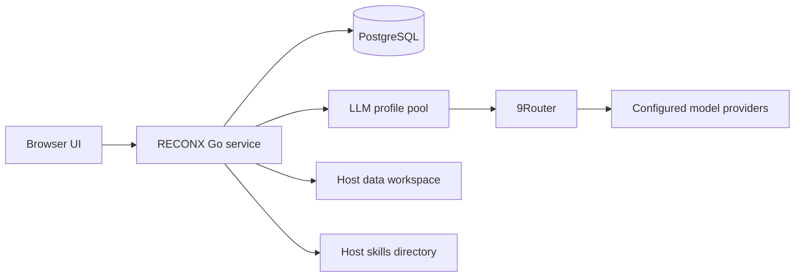

# Architecture

## System shape

RECONX is a single Go service with an embedded static Next.js interface,
backed by PostgreSQL. Docker Compose runs the application and database as
separate local containers.



## Application components

### Frontend

- Located under `web/`.
- Built as a static Next.js export.
- Copied to `server/webui/dist`.
- Embedded into the Go binary with the `embedui` build tag.
- Talks to backend APIs on the same origin.

### Backend

- Main entry point: `cmd/artex`.
- HTTP API and authentication: `server/`.
- Agent orchestration and provider integration: `agent/`.
- Task, graph, findings, traffic, evidence, reporting, and notification
  packages are represented by their corresponding top-level directories.
- PostgreSQL schema and data access: `db/`.

The entry-point directory and executable output use different names: the
source package remains `cmd/artex` for compatibility, while the distributed
binary is `reconx`.

### Agent runtime

The existing planner/worker architecture is preserved. Task state is persisted
so admitted work can resume after service restarts. Agent actions pass through
the application's existing permission and interception boundaries.

Side questions entered with `/btw` use a bounded snapshot of the current agent
context. They have independent cancellation and must not execute tools or
mutate the parent transcript.

### LLM routing

RECONX selects the active profile from `llm_profiles`, then builds a provider
pool from profiles that have usable credentials. A profile contains its
format, model, base URL, secret, limits, and routing settings.

Current local routing:

```text
RECONX -> https://9router.dinhvaren.io.vn/v1
       -> ocg/deepseek-v4.1-flash (default)
       -> ocg/minimax-m3.1-flash
       -> ocg/glm-5.3-flash
       -> ocg/kimi-k3.1-pro
```

The OpenAI-compatible provider normalizes the base URL and appends
`/chat/completions`, avoiding a duplicated `/v1`. Profile changes applied in
the UI are hot-reloaded by the running service.

### Skill library

Skills are loaded from the host `./skills` directory and mounted into the
container at `/app/skills`. Each subdirectory exposes a `SKILL.md` manifest and
may include references or helper scripts.

RECONX ships with the 83-skill Claude-BugHunter collection pinned at commit
`d5dcc5347675ed431488e0a0e46749e4918aa194`, in addition to the application's
pre-existing skills. The skill registry exposes skill names and descriptions to
an agent only after that skill is enabled for the agent in `System -> Skill`.

Installing a skill does not execute its scripts. Skills are instructions loaded
on demand by the agent; related scripts are only run if the agent explicitly
invokes them through the normal tool and approval path.

## Persistence

| Storage | Docker location | Contents |
| --- | --- | --- |
| PostgreSQL | `pgdata` volume | Tasks, graph state, agents, users, findings, settings, profiles |
| JWT keys | `jwtkeys` volume | Signing material kept outside the data workspace |
| Data workspace | Host `./data` | Runtime data, local indexes, evidence blobs, and task artifacts |
| Skills | Host `./skills` | Filesystem-backed skill definitions and references |

PostgreSQL data and `jwtkeys` must survive container recreation. Do not remove
Docker volumes as part of a routine update.

## Docker boundary

The checked-in Compose file:

- Uses local image `reconx:local` with `pull_policy: never`.
- Publishes only `${RECONX_BIND}:${RECONX_PORT}`.
- Defaults both to loopback and port `8787`.
- Keeps PostgreSQL unpublished.
- Uses `no-new-privileges`.
- Does not mount the Docker socket.
- Does not use host networking or privileged mode.

The complete runtime inventory and audit limitations are recorded in the
[security and build report](../SECURITY_BUILD_REPORT.md).
