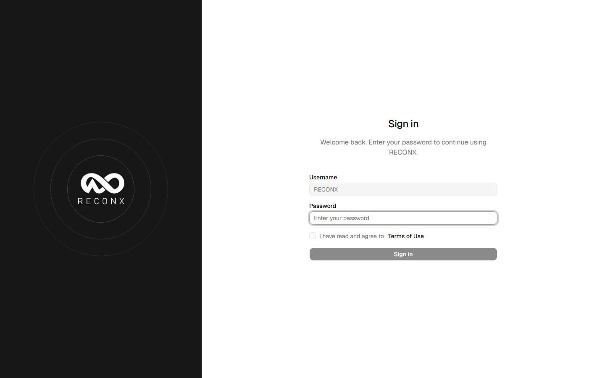
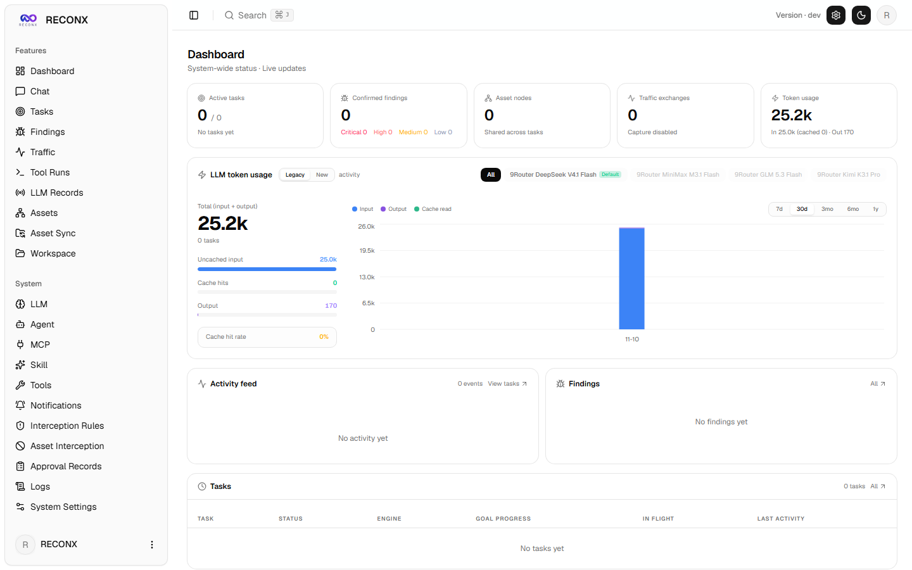
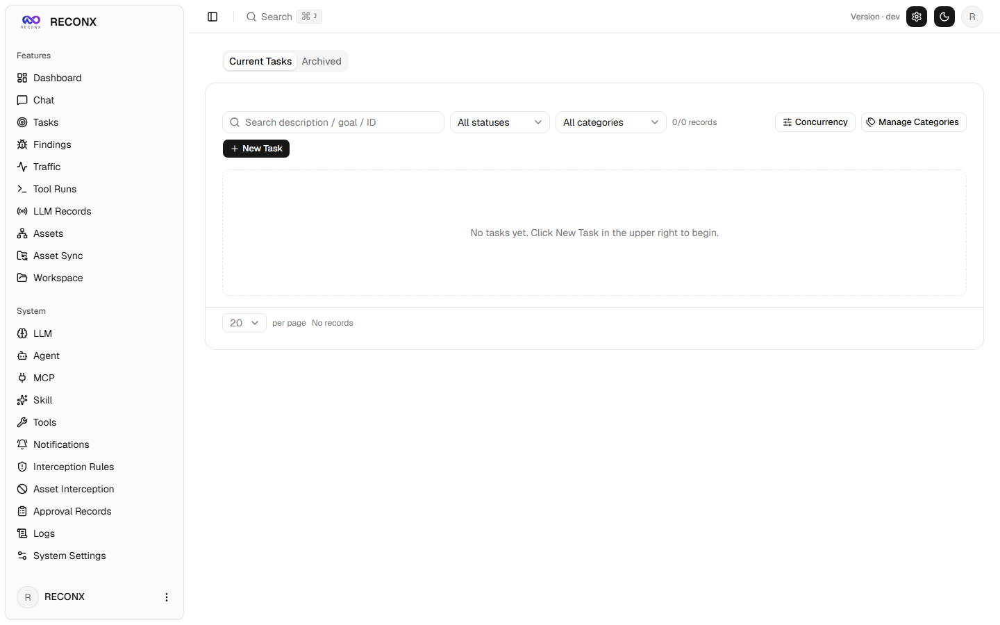
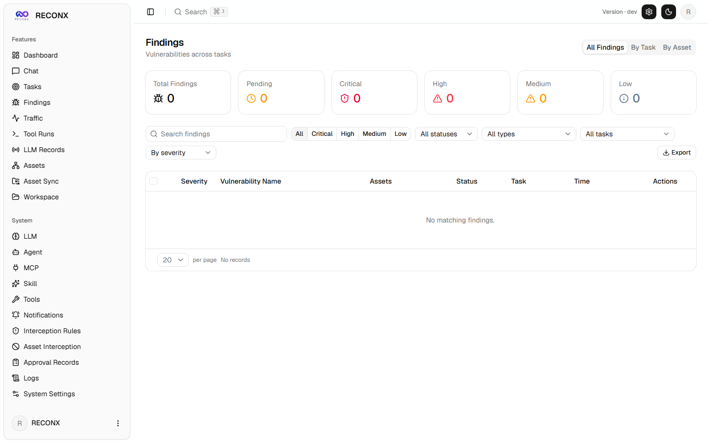
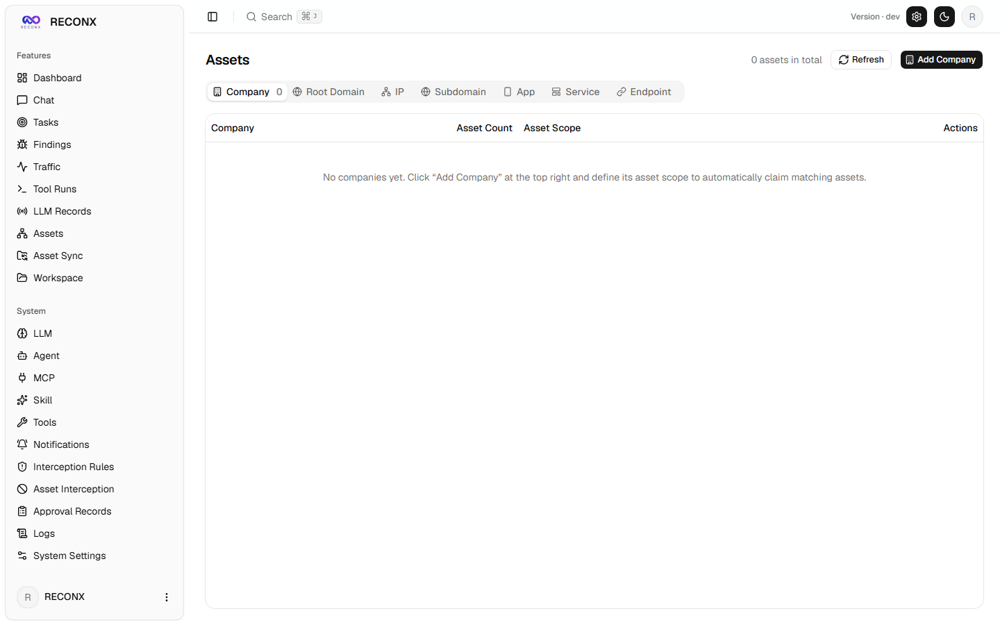
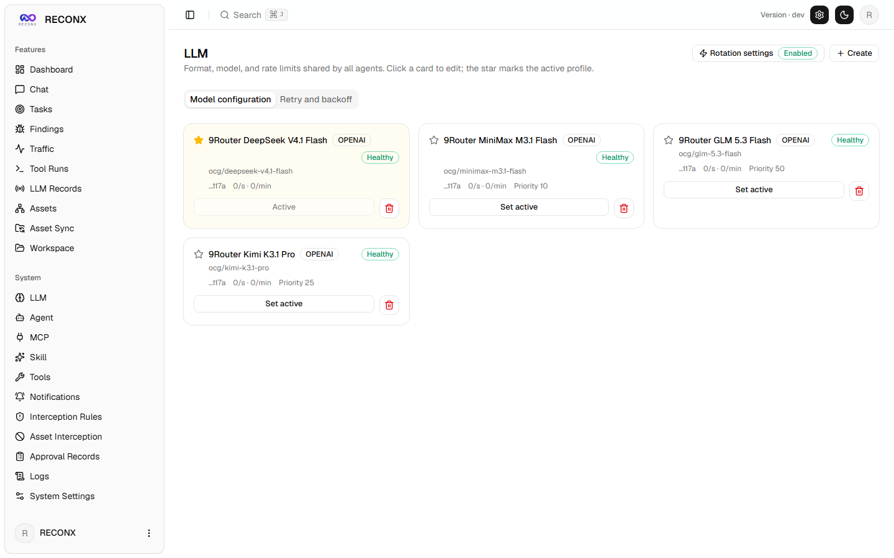

# RECONX Documentation

This directory documents the local RECONX distribution and its supported
operating workflow.

## Application screenshots

Captured from the local RECONX build at 1440 x 900. These views use an empty
workspace so the documentation does not expose assessment targets or findings.

| Login | Dashboard |
| :---: | :---: |
|  |  |

| Tasks | Findings |
| :---: | :---: |
|  |  |

| Assets | LLM profiles |
| :---: | :---: |
|  |  |

## Guides

- [Architecture](ARCHITECTURE.md): components, data flow, persistence, and LLM
  routing.
- [Operations](OPERATIONS.md): build, start, health checks, backups, logs, and
  troubleshooting.
- [Security](SECURITY.md): trust boundaries, secret handling, supply-chain
  controls, and residual risk.
- [Development](DEVELOPMENT.md): repository layout, build/test loop, and
  compatibility identifiers.
- [Security and build report](../SECURITY_BUILD_REPORT.md): current audit,
  image, runtime, and verification evidence.

Documentation conventions:

- Examples target PowerShell on Windows unless a section says otherwise.
- `D:\RECONX` is the project root used by the local deployment.
- Do not place real credentials in documentation, examples, screenshots, or
  committed configuration.
- Keep compatibility notes explicit when an internal name retains a legacy
  identifier.
